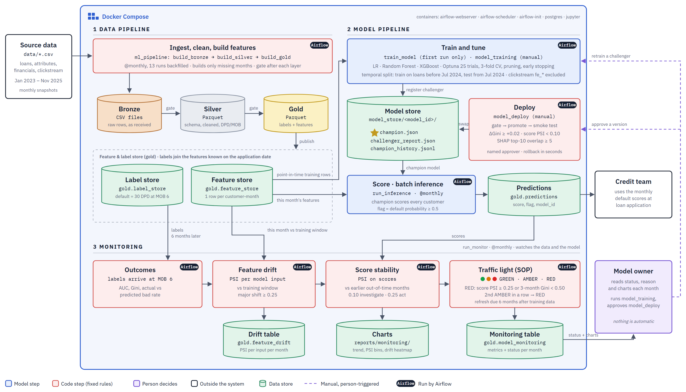
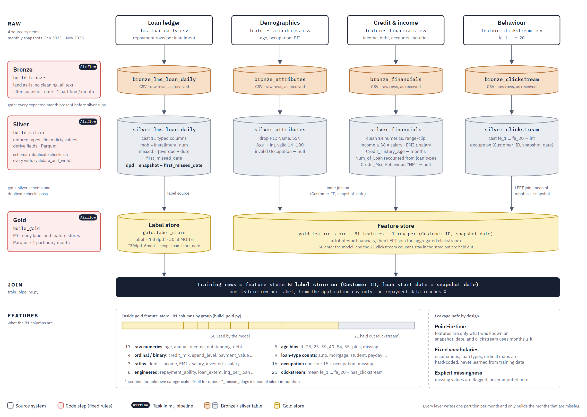
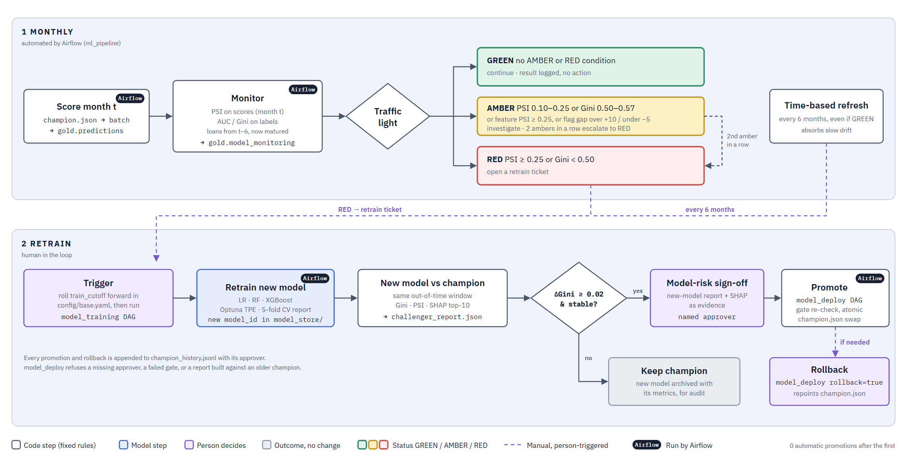

# CS611 Assignment 2: Predicting loan default at application

An end-to-end ML pipeline, orchestrated by Airflow inside Docker, that predicts whether a cash loan
will default at the point of application. Each month it builds the datamart, scores every customer
with the live model, and monitors the model. Changing the live model always needs a named approver.

| Result | Value |
|---|---|
| Champion | XGBoost, out-of-time AUC 0.816, Gini 0.63 (95% CI 0.60–0.66) |
| Backfill | 13 monthly runs (Jan 2024 – Jan 2025), 78/78 Airflow tasks green |
| Stability | score PSI ≤ 0.07 every out-of-time month, largest feature PSI 0.06 |
| Open issue | over-flags by 5.8 percentage points at the 0.5 cut-off, inside the 10-point alert limit |



## Run it

```bash
docker-compose build
docker-compose up          # Airflow at http://localhost:8080 (admin / admin)
```

Unpause **`ml_pipeline`**. It backfills 13 monthly runs and, on its first run, creates everything
from `data/`: datamart, models, predictions and monitoring.

| DAG | Trigger | Tasks |
|---|---|---|
| `ml_pipeline` | `@monthly`, catchup | `build_bronze` → `build_silver` → `build_gold` (each builds only missing months, then gates) → `train_model` (first champion only, then skips) → `run_inference` → `run_monitor` |
| `model_training` | manual | `check_gold` (fails if gold is incomplete) → `train_challenger` (new model + report, never promotes) |
| `model_deploy` | manual | `check_request` → `check_gate` → `promote` → `check_deployment` |

One DAG builds and scores each month, because both share the same monthly schedule. Only the steps
with a different trigger, training and deployment, are separate DAGs.

Outputs: `model_store/` (model bank), `datamart/gold/predictions`, `datamart/gold/model_monitoring`,
`datamart/gold/feature_drift`, `reports/monitoring/*.png`.

## 1. Problem framing

| | |
|---|---|
| Unit | one loan application |
| Target | ≥ 30 days past due (DPD) at month-on-book (MOB) 6 |
| Base rate | 28.9% train · 28.7% test |
| Volume | 12,500 labelled loans · 60 model inputs |
| Explainability | required: SHAP shows why a loan is flagged |

**Default definition.** 30 DPD at MOB 6 was chosen over MOB 3 (misses late defaults) and 90 DPD at
MOB 12 (Basel-style, 12-month lag). In the EDA every loan overdue at MOB 6 has missed at least 2
instalments (59 to 184 DPD), so ≥ 30 DPD (28.8%) and ≥ 60 DPD (28.4%) give almost the same label.
Only 90 DPD changes it (23.0%).

**Leakage controls.**

| Type | Risk | Control |
|---|---|---|
| Target | ledger holds overdue amount, balance, DPD | the ledger builds labels only, no repayment fields reach the features |
| Train-test | imputer or scaler fit on all rows | transforms live inside the sklearn Pipeline, refit per CV fold |
| Temporal | later months seep into features | features as of `loan_start_date`, out-of-time split at 2024-07-01 |

Design rule: build the inputs from application-day data and the outcome from later repayment data,
and join them only to create training rows.

## 2. Data pipeline



Four raw sources land in **bronze**, are cleaned in **silver**, and become a **label store** and an
**81-column feature store** in **gold**, joined on the loan start date. The model uses 60 features.

**Feature set.** Personal Assignment 1 is the base. Of the three sample datamarts, Samples A and B add
almost no features, so only Sample C's ratio ideas (debt ÷ income, EMI ÷ salary, balance ÷ debt,
inquiries ÷ loans, credit-limit flag) were added.

| Count | Group | Technique | Why |
|---|---|---|---|
| 17 | raw numerics | kept as is | the base signal |
| 4 | ordinal codes | e.g. `Credit_Mix` Bad < Standard < Good | keeps the order as numbers |
| 3 | ratios | debt ÷ income, EMI ÷ salary, invested ÷ salary | burden relative to income |
| 6 | engineered | salary − EMI, inquiries ÷ loans, … | cash headroom, credit seeking |
| 5 | age bins | `lt_25` … `55_plus`, missing | risk is not linear in age |
| 9 | loan-type counts | free-text loan list split | one column per loan type |
| 16 | occupation | one-hot plus a missing flag | a gap becomes a signal |
| 21 | clickstream | `fe_1` … `fe_20`, `has_clickstream` | **held out** (below) |

**Why clickstream is held out.** It exists only for loans before Jul 2024, so it lifts CV AUC to about
0.90 but lowers out-of-time AUC (0.804 with it vs 0.810 without). New applicants arrive without it.

**Leakage-safe by design:** features use only data known on `snapshot_date`, category lists are fixed
rather than learned, and missing values are flagged (`-1` for unknown categories, `*_missing` flags).

| Layer | Tables | Format |
|---|---|---|
| bronze | `lms_loan_daily`, `attributes`, `financials`, `clickstream` (raw strings, one file per month) | csv |
| silver | same 4 tables: schema enforced, dirty values cleaned, PII dropped, DPD/MOB derived | parquet |
| gold | `label_store` (30 DPD at MOB 6), `feature_store` (81 features per customer per month) | parquet |

## 3. Model training and selection

| Step | Choice | Alternatives |
|---|---|---|
| Split | train 8,974 loans (Jan 2023 – Jun 2024), test 3,526 unseen loans (Jul 2024 – Jan 2025) | random split |
| Validation | stratified CV inside train: 3 folds for tuning, 5 for the report | time-ordered folds |
| Tuning | Optuna TPE, 25 trials with pruning: 2 h → under 5 min | grid, random search |
| Imbalance | class weights, no resampling | undersample, SMOTE |
| Inputs | 60 of 81, no clickstream | all 81 |

Stratified folds keep the 29% bad rate in every fold. CV AUC matches the out-of-time test AUC, so the
folds show no leakage.

| Model | Role | Test AUC | Gini | CV AUC |
|---|---|---|---|---|
| Logistic regression | simple baseline | 0.768 | 0.536 | 0.769 |
| Random forest | non-linear effects | 0.808 | 0.616 | 0.807 |
| **XGBoost** ★ | boosting on errors | **0.816** | **0.632** | **0.814** |

AUC is the chance a bad loan scores above a good one (0.5 = coin flip). Gini = 2 × AUC − 1, the credit
industry scale. XGBoost wins because logistic regression fits only straight lines, missing thresholds
and interactions, and boosting fixes each tree's errors, edging out random forest. Top features by mean
absolute SHAP: `outstanding_debt` 0.44, `interest_rate` 0.28, `delay_from_due_date` 0.26,
`spend_level` 0.19, `num_credit_card` 0.18.

## 4. Model bank and inference

```
model_store/
├ champion.json              pointer to the live model
├ champion_history.jsonl     audit trail
├ <run>_<model>/
│ ├ model.pkl                imputer + classifier as one sklearn Pipeline
│ ├ feature_cols.json        the 60 inputs, in trained order
│ ├ metadata.json            train_cutoff, train_size, params, metrics
│ └ challenger_report.json   new model vs champion (retrain runs)
└ optuna.db                  tuning studies, resumable (the only versioned file)
```

Every row of `gold.predictions` carries the `model_id` that made it, which links back to
`model_store/<id>/metadata.json`.

| Step | What happens | Guard |
|---|---|---|
| Load | `champion.json` → `model.pkl` | pointer swapped atomically (temp file, then `os.replace`) |
| Read | `gold.feature_store` for month t | no data for the month → run skips and logs it |
| Align | select the 60 features in trained order | missing column → `ValueError`, run stops |
| Score | `predict_proba` → 0–1 score, flagged at ≥ 0.5 | smoke test on 500 rows before any model goes live |
| Write | `gold.predictions` + `model_id`, `scored_at` | schema and duplicate-key check, reruns overwrite |

Preprocessing lives inside `model.pkl`, so scoring cannot drift from training. Monthly batch matches the
monthly snapshots and needs no serving infrastructure. An online API would put the same `model.pkl`
behind FastAPI. Streaming has no event source in this data.

## 5. Monitoring

Drift in scores and features is checked as soon as a month is scored. Accuracy and the flagging rate
are checked six months later, once loans have outcomes. Each `run_monitor` writes one row to
`gold.model_monitoring` and PSI per feature to `gold.feature_drift`, raises a GREEN / AMBER / RED
alert (logged in Airflow and stored with its reason), and redraws the charts in `reports/monitoring/`.

| Check | Measure | AMBER | RED |
|---|---|---|---|
| Score stability | PSI of scores vs earlier out-of-time months | ≥ 0.10 | ≥ 0.25 |
| Performance | Gini, mean of the last 3 labelled months | < 0.57 | < 0.50 |
| Feature drift | PSI of each feature vs the training window | any ≥ 0.25 | |
| Calibration | flag gap: predicted bad rate (score ≥ 0.5) minus actual, mean of the last 3 labelled months | > +0.10 or < −0.05 | |
| Escalation | second AMBER in a row | | RED |

| Threshold | Reason |
|---|---|
| PSI 0.10 / 0.25 | credit-industry bands for minor and major shift |
| Gini 0.57 | 10% relative drop from 0.63 at sign-off |
| Gini 0.50 | about a 20% drop, the model ranks risk much worse |
| Flag gap +10 / −5 | missing bad loans costs more than flagging a few good ones, so under-flagging alerts sooner |
| 3-month mean | one month of ~500 loans has a Gini 95% interval of about ±0.09 |

PSI (population stability index) scores how far this month's mix of values has moved from normal:
0 means no change, under 0.10 is small, 0.25 or more is a major shift. `refresh_due` is set once the
training data is 6 months old. Alerts never retrain anything: RED logs a warning and a person runs
`model_training`. Thresholds live in `config/base.yaml` under `ml.monitoring`.

**Results, Jan 2024 – Jan 2025.** Every month stayed GREEN. Pooled Gini 0.63 (95% CI 0.60–0.66), the
Jan 2025 dip to 0.56 is within monthly noise. Scores stayed stable (PSI ≤ 0.07). Scores run high
(average 0.42 vs an actual bad rate of 0.29, a cost of class weighting), so the model flags 5.8 points
too many loans as bad. A 0.62 cut-off would flag 28.6%, matching the actual rate. The 6-month refresh
flag fires in Jan 2025. The out-of-time months are the training holdout, so they confirm the 0.816 AUC
rather than add new evidence.

## 6. Governance and refresh SOP



Selection within a training run is automatic. **Changing the live model is not**: only the very first
model is promoted automatically.

| Situation | What happens |
|---|---|
| No `champion.json` (first run) | best of LR / RF / XGBoost is promoted (`promoted_by: bootstrap`) |
| Retrain (`model_training`) | the best candidate is saved as a new model (challenger) with `challenger_report.json`, scored against the champion on the same out-of-time window. `champion.json` is unchanged |
| Promote (`model_deploy`) | a person reviews the report and triggers `model_deploy` with `model_id` and `approved_by`. The gate is re-checked |
| Rollback | `model_deploy` with `rollback=true` and a former champion's `model_id` |

| Gate check | Rule | Why |
|---|---|---|
| Gini uplift | ≥ +0.02 | about one CV standard deviation, so a win is not luck |
| Stability | score PSI < 0.10 | early vs late half of the out-of-time window |
| SHAP sanity | ≥ 5 of the champion's top 10 features kept | no surprise drivers (reported, not blocking, if SHAP cannot run) |

`model_deploy` refuses to promote when there is no named approver, the `model_id` is not in
`model_store/`, there is no report or the gate says KEEP, the report was built for an older champion,
a rollback targets a model that was never champion, or the smoke test fails on 500 rows.

Every change appends one line to `model_store/champion_history.jsonl`: `model_id`,
`previous_model_id`, `promoted_by` (bootstrap | manual | rollback), `approved_by`, `reason`,
`updated_at`.

| Owner | Role |
|---|---|
| Data Science team | runs training |
| Engineering team | DAGs, gate code |
| Model Risk (independent) | approves the swap |
| Business Owner | owns the score cut-off |

Model Risk is kept separate from the Business Owner because the business gains from approving more
loans, so an independent team signs off the model before it goes live.

```bash
# inside the scheduler container
airflow dags trigger model_training
airflow dags trigger model_deploy --conf '{"model_id": "<id>", "approved_by": "<name>", "reason": "..."}'
```

## 7. Reproducibility, limits and next steps

- Both images pin `numpy 2.2.2`, `scikit-learn 1.6.1`, `xgboost 2.1.4`: model pickles are version-sensitive.
- Tuning fell from 2 h to under 5 min: XGBoost on 4 threads instead of 16 (one trial 433 s → 13 s),
  25 trials instead of 50, 3 tuning folds, pruning and early stopping.
- Every table-month is one Parquet partition, so reruns overwrite and never duplicate.
- 88 unit tests (`python -m pytest tests`).

| Limit | Next step |
|---|---|
| over-flags 5.8 pp (alert above 10 pp) | recalibrate, or move to a 0.62 score cut-off |
| monthly Gini is noisy | store bootstrap intervals in `gold.model_monitoring` |
| CV folds are not time-ordered | add a rolling, time-ordered validation window |
| refresh due Jan 2025 | roll `train_cutoff` forward and run `model_training` |

## Data pipeline jobs (from Assignment 1)

The medallion layers can also be run without Airflow, from the JupyterLab container:

```bash
docker-compose up          # JupyterLab at http://localhost:8888
# in a JupyterLab terminal:
python main.py             # builds datamart/ (~6 min)
python -m pytest tests     # unit tests
python -m pipelines.ingest_pipeline    --snapshotdate 2024-01-01 [--source attributes]
python -m pipelines.transform_pipeline --snapshotdate 2024-01-01 [--source attributes]
python -m pipelines.feature_pipeline   --snapshotdate 2024-01-01 [--table label_store]
```

The same commands are available as `make build | up | pipeline | test | eda | clean`.

Point-in-time join of features to labels:

```python
from utils.features.feature_store import get_training_data
df = get_training_data(spark)   # labels.loan_start_date == features.snapshot_date
```

## Project structure

```
├── main.py                      # full datamart backfill: bronze -> silver -> gold
├── Dockerfile, Dockerfile.airflow, docker-compose.yaml, requirements*.txt
├── Readme.txt                   # submission: link to this repo
├── Makefile
├── config/
│   ├── base.yaml                # sources, windows, label, model and monitoring settings
│   └── schemas/{silver,gold}/   # expected schema per table, validated before every write
├── dags/                        # ml_pipeline, model_training, model_deploy
├── data/                        # raw source CSVs (gitignored)
├── datamart/                    # generated bronze / silver / gold (gitignored)
├── docs/                        # architecture, data pipeline and governance diagrams
├── model_store/                 # model bank (only optuna.db is versioned)
├── notebooks/01_eda.ipynb       # exploration behind the cleaning rules and model design
├── pipelines/                   # data jobs per layer + train / inference / monitor pipelines
├── reports/monitoring/          # monitoring charts
├── tests/unit/                  # cleaning, gold features, layers, training, drift, promotion
└── utils/
    ├── common/                  # config, Spark session, datamart IO, logging, dates
    ├── ingestion/               # raw -> bronze
    ├── transformation/          # bronze -> silver: cleaning rules, validation
    ├── features/                # silver -> gold: feature definitions, feature store
    └── ml/                      # model store, promotion gate, drift and alerts
```
